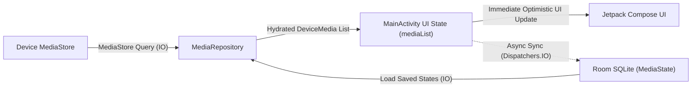

# Technical Architecture & Engineering Decisions

## 1. Overview
**Your Gallery** is built as an offline-first, performance-centric media gallery. It operates on two foundational principles:
1. **Never block the UI thread**: Touch response and gesture interactions must maintain 120Hz/144Hz fluidity.
2. **Never mutate source binaries destructively**: All user categorization, favoriting, album assignment, and trash operations must be virtualized.

---

## 2. In-Memory Reactive Loop & Room State Injection

### Problem
Directly writing file tags or moving photos into hidden folders on Android triggers file-system re-indexes, causes storage permission hurdles across Android 10-14 Scoped Storage, and degrades performance.

### Solution
- `MediaStore.Images` and `MediaStore.Video` are queried via `ContentResolver` on `Dispatchers.IO`.
- An independent SQLite database managed by Room (`GalleryDatabase`, table `media_states`) maintains:
  - `isFavorite: Boolean`
  - `isHidden: Boolean`
  - `isEdited: Boolean`
  - `trashedAt: Long` (Recycle bin timestamp)
  - `caption: String`
  - `tags: String`
  - `albums: String` (comma-delimited custom albums)
- When a user favorites, trashes, or tags a photo:
  1. The in-memory `mediaList` state in Compose updates **instantly** (0ms latency).
  2. A coroutine launched on `Dispatchers.IO` writes the changes asynchronously to `mediaStateDao`.

---

## 3. Gesture Coordination: Paging vs. Pinch-to-Zoom

### Problem
In Android Jetpack Compose, nesting a zoomable/pannable item inside a horizontal `HorizontalPager` often causes gesture conflicts: panning inside a zoomed photo accidentally navigates to the next photo.

### Solution (`ViewerScreen.kt`)
1. **Dynamic Scroll Locking**:
   - `HorizontalPager` is controlled by `userScrollEnabled = (currentZoomScale <= 1.05f)`.
   - When the user pinches to zoom past `1.05x`, pager scrolling is deactivated.
2. **Gesture Pointer Consumption**:
   - Horizontal touch gestures at `1.0x` zoom are left unconsumed, allowing `HorizontalPager` to intercept and swipe naturally between photos.
   - Panning gestures at `> 1.05x` consume drag deltas within the bounded coordinate box, preventing accidental page switches.

---

## 4. Sub-Pixel Fast Scroller Mathematics

The floating Date Capsule Badge (`[ Nov 2024 ]`) calculates position using continuous fractional offsets:
$$\text{Progress} = \frac{\text{FirstVisibleIndex} + \frac{\text{FirstVisibleItemScrollOffset}}{\text{EstimatedItemHeight}}}{\text{TotalItemCount}}$$

This guarantees smooth 60–120fps tracking across thousands of photos without snapping, layout thrashing, or scrollbar duplication.

---

## 5. Viewport Unprojection Engine (Samsung Quick Crop)

When zooming into an image in `ZoomableImageItem`, the visible viewport on screen corresponds to a transformed sub-rectangle of the original bitmap. Rather than capturing a screen-resolution snapshot (which would pixelate), the engine solves for exact bitmap coordinates:

Given container dimensions $W \times H$, source dimensions $W_{\text{img}} \times H_{\text{img}}$, zoom scale $S$, and translations $T_x, T_y$:
$$x_{\min} = \frac{W}{2} - \frac{\frac{W}{2} + T_x}{S}, \quad x_{\max} = \frac{W}{2} + \frac{\frac{W}{2} - T_x}{S}$$
$$y_{\min} = \frac{H}{2} - \frac{\frac{H}{2} + T_y}{S}, \quad y_{\max} = \frac{H}{2} + \frac{\frac{H}{2} - T_y}{S}$$

These bounds are mapped through the aspect-ratio fitted offsets to extract the crop directly from the high-res decoded source bitmap, yielding loss-free exports.

---

## 6. Multi-Photo Collage Studio Engine (Honor Signature)

The Collage Studio dynamically lays out 2 to 6 photos across 3 aspect ratios (`1:1`, `4:5`, `9:16`):
- **Live Vector Preview**: Jetpack Compose renders responsive layout cells with clip-path corner radii and spacing.
- **Hardware-Accelerated Composite Export**: Generates a high-res ($2400 \times N$) canvas on `Dispatchers.IO`, center-crops each source bitmap to its cell's aspect ratio, applies rounded-rect clipping paths, and renders the composite into MediaStore `Pictures/YourGallery`.

---

## 7. Web Companion Architecture (PWA)

- **Storage Engine**: `IndexedDB` (`your-gallery-db`) stores photos, custom albums, and settings.
- **Directory Sync**: Utilizes the modern **File System Access API** (`showDirectoryPicker`) to directly read local phone folders (e.g. `DCIM/Camera`), extracting EXIF metadata in real time via binary stream decoding.
- **Offline Service Worker**: Powered by `vite-plugin-pwa` with Workbox offline precaching of UI assets and icons.
